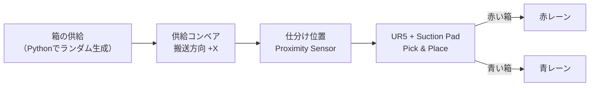

# coppeliasim-conveyor-sorting

**CoppeliaSim × Python：ベルトコンベア色別仕分けロボット デモ**

このリポジトリは、**JAIST（北陸先端科学技術大学院大学）2026年度 Ⅲ期 Robotics の授業**で使うロボットシミュレーション教材です。

CoppeliaSim 上でベルトコンベアを動かし、流れてくる赤い箱と青い箱を UR5 ロボットアームが吸着して、色ごとのレーンへ振り分けます。箱の生成、搬送、センサーによる検出、ロボットの動作、仕分けの判定、結果の評価までを Python（ZeroMQ Remote API）で自動化します。

> **現在の状況**：設計書（[`docs/design.md`](docs/design.md)）を公開した段階です。シーンファイルとソースコードは、授業の進行に合わせて順に追加します。

---

## デモの流れ



1. Python が赤または青の箱をランダムに生成する
2. 箱がベルトとの接触・摩擦によって物理的に運ばれる
3. 仕分け位置に着いた箱を Proximity Sensor が検出する
4. コンベアを止め、箱の色を判定する
5. UR5 が箱を吸着して持ち上げる
6. 赤い箱は赤レーン、青い箱は青レーンに置く
7. ロボットが待機位置（Home）に戻り、コンベアを再開する

最初は、箱を止めてからつかむ **Stop-and-Pick 方式**で作ります。動いている箱を追いかけてつかむ Conveyor Tracking は発展課題です。

## 授業で扱う内容

| 分野 | このデモで扱う内容 |
|---|---|
| センサー | Proximity Sensor による到達検出、Vision Sensor による色認識 |
| 判断・制御 | 色に応じた置き場所の選択、状態遷移（State Machine） |
| 運動学 | simIK で逆運動学を解き、手先を目標位置へ動かす |
| 把持と搬送 | 吸着、上昇、移動、解放 |
| 物理シミュレーション | ベルトとの接触・摩擦による箱の搬送 |
| 評価 | 仕分け成功率、サイクルタイム、処理能力、位置誤差、失敗件数 |

## 使用環境

| 項目 | 内容 |
|---|---|
| シミュレーター | CoppeliaSim |
| 言語 | Python 3 |
| 通信 | ZeroMQ Remote API（`coppeliasim-zmqremoteapi-client`） |
| ロボット | UR5（UR10 も可） |
| グリッパー | Suction Pad（初期は親子関係の付け替えによる簡易吸着） |
| コンベア | Generic conveyor (belt) |
| センサー | Proximity Sensor、Vision Sensor（Step 8） |
| 逆運動学 | simIK |
| 画像処理 | OpenCV（Step 8 で使用） |

### セットアップ

```bash
pip install coppeliasim-zmqremoteapi-client
# Step 8（画像による色認識）で使用
pip install opencv-python numpy
```

CoppeliaSim を起動してシーンを開いた状態で、Python スクリプトを実行します。ZeroMQ Remote API のアドオンは CoppeliaSim の起動時に自動で読み込まれます。

## 8つのステップ

| Step | 作業 | 完成条件 |
|---|---|---|
| 1 | コンベアを設置する | ベルトが回る |
| 2 | 赤・青の箱を生成する | 箱がベルトで運ばれる |
| 3 | センサーを設置する | 指定の位置でベルトが止まる |
| 4 | UR5 と吸着部を設置する | アームが目標位置まで動く |
| 5 | 箱を吸着・解放する | 箱を持ち上げて置ける |
| 6 | 色別に仕分ける | 赤と青を正しいレーンに置ける |
| 7 | Python で連続自動運転する | 10個以上の箱を続けて処理できる |
| 8 | Vision Sensor で認識し、評価する | 画像で色を分類し、成功率を表示できる |

各ステップの手順とサンプルコードは [`docs/design.md`](docs/design.md) にあります。

## シーン内のオブジェクト名（Alias）

Python からは次の Alias でオブジェクトを参照します。シーンを作るときは、この名前に合わせてください。

| Alias | 対象 |
|---|---|
| `/conveyor` | 供給コンベア（Generic Conveyor） |
| `/pickSensor` | 仕分け位置の Proximity Sensor |
| `/redPlace` | 赤い箱の置き場所 |
| `/bluePlace` | 青い箱の置き場所 |
| `toolTip` | UR5 の手先 |
| `ikTarget` | IK の目標位置（Dummy） |
| `attachPoint` | 吸着した箱を取り付ける点 |

## 予定しているディレクトリ構成

```text
coppeliasim-conveyor-sorting/
├── docs/
│   └── design.md            # 設計書（公開済み）
├── scenes/
│   └── conveyor_sorting.ttt # CoppeliaSim シーン
├── src/
│   ├── main.py              # シミュレーションの起動、状態遷移、全体の実行
│   ├── simulation.py        # Remote API 接続、sim.step、終了処理
│   ├── conveyor.py          # ベルトの速度・停止・再開
│   ├── box_spawner.py       # 赤・青の箱のランダム生成と出現位置
│   ├── detector.py          # センサーの読み取り、対象の箱の取得
│   ├── robot_controller.py  # UR5・IK・補間軌道・Home 復帰
│   ├── gripper.py           # Attach / Release
│   ├── sorter.py            # 色の判定、置き場所の選択
│   └── logger.py            # 結果の CSV 出力、成功率、処理時間
├── tests/
├── config.yaml              # 速度・サイズ・座標などのパラメータ
├── pyproject.toml
└── README.md
```

## 評価指標

| 項目 | 測定内容 |
|---|---|
| 仕分け成功率 | 正しいレーンに置いた箱の数 ÷ 全体の箱の数 |
| サイクルタイム | 箱1個の仕分けにかかった時間 |
| 処理能力 | 1分間に仕分けた箱の数 |
| 位置誤差 | ロボットの手先と目標位置のずれ |
| 搬送失敗 | 落下、把持の失敗、箱の詰まり |

各試行の結果は CSV に記録し、授業の成果物として提出・発表に使います。

## 発展課題

- Vision Sensor と OpenCV（HSV 色空間）による画像での色分類
- 出力レーンのコンベア化
- 動いている箱を追ってつかむ Conveyor Tracking
- Suction Pad モデルによる物理的な吸着

## 注意事項

- `docs/design.md` のコードは、各ステップを確認するための**サンプル**です。全モジュールを結合した完成版のアプリケーションではありません。
- Alias やオブジェクトのパスは、実際のシーンの Scene Hierarchy に合わせて調整してください。
- コンベアの制御（`__ctrl__`、`vel`）は、Generic Conveyor モデル側のスクリプトがこのインターフェースに対応していることが前提です。
- 例外が起きたときも、コンベアの停止、シミュレーションの停止、接続の後始末を行うようにしてください。

## 参考資料

- [CoppeliaSim 公式マニュアル](https://manual.coppeliarobotics.com/en/welcome.htm)
- [CoppeliaSim チュートリアル](https://manual.coppeliarobotics.com/en/tutorials.htm)
- [ZeroMQ Remote API](https://github.com/CoppeliaRobotics/zmqRemoteApi)
- [CoppeliaSim 公式フォーラム](https://forum.coppeliarobotics.com/)
- [Robotic Pick and Place Simulation Using CoppeliaSim（Instructables）](https://www.instructables.com/Robotic-Pick-and-Place-Simulation-Using-CoppeliaSi/)
- [CoppeliaSim-RobotArm-PickAndPlace（GitHub）](https://github.com/sunday-ikechukwu/CoppeliaSim-RobotArm-PickAndPlace)
