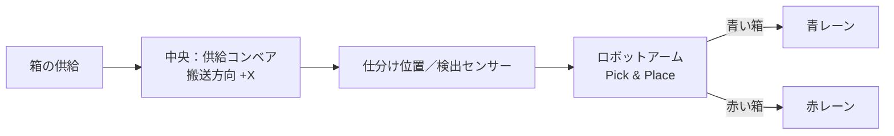
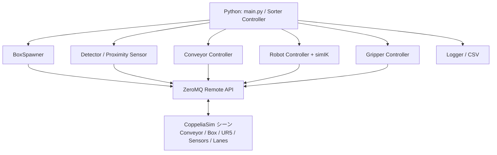
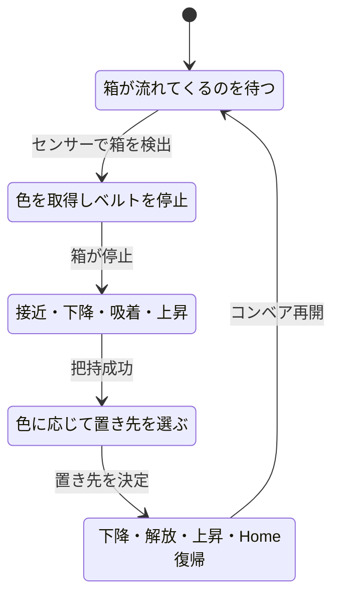
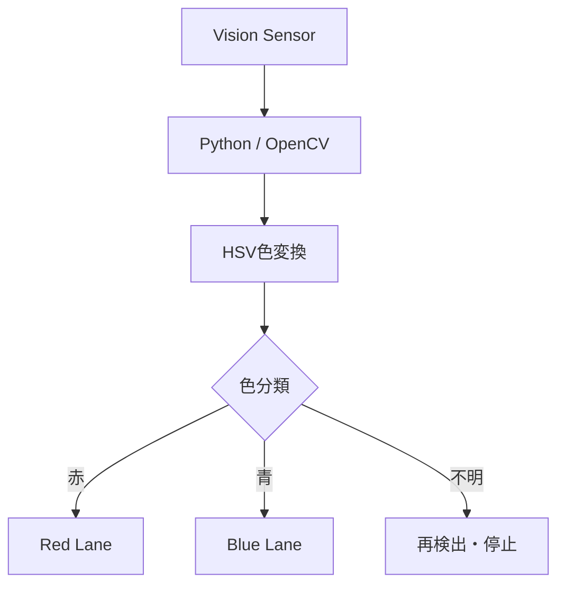

# CoppeliaSim × Python：ベルトコンベア色別仕分けロボット デモ設計書

> **目的**：授業用のロボットシミュレーションとして、ベルトコンベアを実際に動かし、流れてくる赤い箱・青い箱をロボットアームがつかみ、それぞれ指定されたレーンへ振り分ける。Pythonで箱の生成、搬送、センサー検出、ロボット動作、仕分け判定、評価を自動化する。
>
> **想定環境**：CoppeliaSim、Python 3、ZeroMQ Remote API（`coppeliasim-zmqremoteapi-client`）、UR5/UR10、Generic Conveyor、Proximity Sensor、Suction Pad、simIK。必要に応じてOpenCVを追加する。
>
> **実装方針**：最初は箱を停止させてからつかむ **Stop-and-Pick方式** とする。基本動作が安定したら、Vision Sensorによる色認識、出力レーンのコンベア化、Conveyor Trackingへ発展させる。

---

## 1. 最終的に作るデモ

赤・青の箱が供給コンベアを流れ、センサーが箱を検出する。コンベアを停止し、ロボットアームが箱を吸着、持ち上げる。赤い箱は赤レーン、青い箱は青レーンへ移してから解放する。ロボットを待機位置へ戻し、コンベアを再始動する。

### 1.1 配置イメージ（上面図・概念図）



実際のシーンでは、供給コンベアの横にロボットを配置し、その可動範囲内に青・赤の出力レーン（最初は受け皿でもよい）を配置する。各部品の高さ、箱の大きさ、グリッパーの到達可能範囲を調整する。

### 1.2 動作シーケンス

1. Pythonが赤または青の箱をランダムに生成する。
2. 箱がコンベア上を物理的に搬送される。
3. 箱が仕分け位置に到達すると、センサーが検出する。
4. コンベアを停止し、箱の色を判定する。
5. ロボットアームが箱を吸着し、持ち上げる。
6. 赤い箱は赤レーン、青い箱は青レーンへ移動して置く。
7. ロボットが待機位置に戻り、コンベアを再開する。

**初期の完成目標**：ベルトを動かし、停止した箱を1個ずつ仕分ける。移動中の箱を追従してつかむ Conveyor Tracking は発展課題とする。

---

## 2. 使用するモデルと技術

| 部品 | CoppeliaSimのモデル・機能 | 役割 |
|---|---|---|
| ロボットアーム | UR5またはUR10 | 6軸のPick & Place |
| グリッパー | Suction Pad | 箱を上面から吸着 |
| 供給コンベア | Generic conveyor (belt) | 箱を物理的に搬送 |
| 箱 | Cuboid（赤・青） | 仕分け対象 |
| センサー | Proximity Sensor | 箱の到達検出 |
| 色認識 | 初期：Pythonの色ラベル／発展：Vision Sensor | 箱の分類 |
| 出力先 | 初期：赤・青の受け皿／発展：出力コンベア | 仕分け先 |
| 制御 | Python + ZeroMQ Remote API | 全体の自動化 |
| 運動学 | simIK | アームの逆運動学 |

### 2.1 実装上の考え方

最初から画像認識や複雑な把持物理をすべて実装せず、機能を段階的に追加する。初期段階では生成時の色ラベルで分類し、動作が安定したらVision Sensor画像による分類へ置き換える。

### 2.2 システム構成



---

## 3. 作業を8段階に分ける

| Step | 作業 | 完成条件 |
|---|---|---|
| 1 | コンベア設置 | ベルトが回転する |
| 2 | 赤・青の箱を生成 | 箱がベルトで運ばれる |
| 3 | センサー設置 | 指定位置でベルトが停止 |
| 4 | UR5と吸着部を設置 | アームが目標位置まで動く |
| 5 | 箱を吸着・解放 | 箱を持ち上げて置ける |
| 6 | 色別仕分け | 赤と青を正しく分配 |
| 7 | Pythonによる連続自動運転 | 10個以上の箱を処理 |
| 8 | Vision Sensor・評価 | 画像分類と成功率を表示 |

---

## 4. Step 1：CoppeliaSimにコンベアを設置する

### 4.1 新しいシーンを作成する

以前作った1自由度アームとは別のシーンを用意する。CoppeliaSimで新規シーンを開き、次の名前で保存する。

```text
conveyor_sorting.ttt
```

### 4.2 コンベアモデルを読み込む

CoppeliaSimのModel Browserで以下を探す。

```text
models
└── equipment
    └── conveyor belts
        └── generic conveyor (belt)
```

モデルブラウザ内の表記はバージョンにより異なる場合があるため、`conveyor` でも検索する。モデルをシーンへドラッグ＆ドロップする。

初期設定例：

| 項目 | 設定 |
|---|---|
| Alias | `conveyor` |
| Position | `(0, 0, 0)` |
| Orientation | ベルトの搬送方向が+X方向 |
| 搬送速度 | 0.08 m/s |
| 搬送する箱 | 0.06 × 0.06 × 0.04 m |
| コンベア長さ | 約1.2m（初期目安） |

コンベアの長さ・幅などはモデルの設定画面で調整する。

### 4.3 Pythonからコンベアを動かす

Generic Conveyorモデルに付属するスクリプトが有効であることを確認する。`test_conveyor.py` を作成する。

```python
from coppeliasim_zmqremoteapi_client import RemoteAPIClient

client = RemoteAPIClient()
sim = client.require('sim')

conveyor = sim.getObject('/conveyor')

sim.setStepping(True)
sim.startSimulation()

try:
    # 搬送開始
    sim.writeCustomTableData(
        conveyor, '__ctrl__', {'vel': 0.08}
    )

    while sim.getSimulationTime() < 5.0:
        sim.step()

    # 搬送停止
    sim.writeCustomTableData(
        conveyor, '__ctrl__', {'vel': 0.0}
    )

    # 減速を確認
    for _ in range(30):
        sim.step()

finally:
    sim.stopSimulation()
```

実行コマンド：

```bash
cd ~/coppeliasim
source .venv/bin/activate
python test_conveyor.py
```

`__ctrl__` は対応するGeneric Conveyorモデルの制御用データであり、`vel` でベルト速度を指定する。**利用するモデルのバージョンにより制御方法が異なることがあるため、モデル付属スクリプトで対応を確認する。** 停止指令後も加減速による遅れがあり得る。

**完成条件**：ベルトが動き、約5秒後に停止する。

---

## 5. Step 2：Pythonで赤・青の箱を自動生成する

### 5.1 箱を物理的に搬送する

箱のワールド座標を毎フレーム直接書き換えるのではなく、コンベアとの**接触・摩擦**で搬送されるようにする。

| 設定 | 値 |
|---|---|
| Body is dynamic | ON |
| Respondable | ON |
| Detectable | ON |
| Mass | 0.1 kg |
| Collision | 有効 |
| Shape | Cuboid |

### 5.2 箱生成プログラム：`spawn_boxes.py`

```python
import random
from coppeliasim_zmqremoteapi_client import RemoteAPIClient

client = RemoteAPIClient()
sim = client.require("sim")

conveyor = sim.getObject("/conveyor")

# 要調整：実際のベルト始端の真上にする
# Zはベルト上面 + 箱の高さの半分 + 少しの隙間
SPAWN_POS = [-0.45, 0.0, 0.25]

BOX_SIZE = [0.06, 0.06, 0.04]

COLORS = {
    "red": [1.0, 0.1, 0.1],
    "blue": [0.1, 0.2, 1.0],
}

def create_box(index):
    name = random.choice(["red", "blue"])

    box = sim.createPrimitiveShape(
        sim.primitiveshape_cuboid,
        BOX_SIZE,
        0
    )

    sim.setObjectAlias(box, f"{name}_box_{index}")

    sim.setShapeColor(
        box,
        "",
        sim.colorcomponent_ambient_diffuse,
        COLORS[name]
    )

    sim.setObjectPosition(
        box, SPAWN_POS, sim.handle_world
    )

    # 物理シミュレーション対象にする
    sim.setBoolProperty(box, "dynamic", True)
    sim.setBoolProperty(box, "respondable", True)
    sim.setBoolProperty(box, "detectable", True)
    sim.setBoolProperty(box, "collidable", True)

    sim.setShapeMass(box, 0.1)

    print(f"Created: {name}_box_{index}")
    return box

sim.setStepping(True)
sim.startSimulation()

try:
    sim.writeCustomTableData(
        conveyor, "__ctrl__", {"vel": 0.08}
    )

    next_spawn = 0.0
    index = 0

    while sim.getSimulationTime() < 25.0:
        t = sim.getSimulationTime()

        if t >= next_spawn:
            create_box(index)
            index += 1
            next_spawn += 4.0

        sim.step()

finally:
    sim.writeCustomTableData(
        conveyor, "__ctrl__", {"vel": 0.0}
    )
    sim.stopSimulation()
```

**実装時の確認事項**：このコードは構成例であり、CoppeliaSimのバージョンに合わせて動的形状の生成オプションと `setBoolProperty` の対応プロパティ名・実行可能タイミングを検証すること。生成時に適切なdynamic/respondable属性を設定する方式が必要な環境もある。

### 5.3 出現位置（SPAWN_POS）の調整

`SPAWN_POS` は例である。実際のコンベアの始端とベルト上面に合わせる。

箱中心の高さは次の目安とする。

\[
z_{\mathrm{spawn}}
=
z_{\mathrm{belt\ top}}+\frac{h_{\mathrm{box}}}{2}+\epsilon
\]

箱の高さが0.04mの場合、ベルト上面から約0.025m上を箱の中心にする設定を試す。

### 5.4 動作確認

まず箱を1個だけ生成し、以下を確認する。

- [ ] 箱がベルト上に落ちる。
- [ ] 箱がベルトと一緒に動く。
- [ ] 箱が床をすり抜けない。
- [ ] 赤・青の色が正しく表示される。

箱が動かない場合は搬送方向・物理設定・摩擦係数を確認する。箱が転倒する場合は速度を下げ、箱の高さや物理エンジン設定を調整する。複数生成する前に1個で確認する。

---

## 6. Step 3：センサーで箱を検出し、コンベアを停止する

### 6.1 Proximity Sensorの設置

CoppeliaSimで `Add > Proximity sensor` から検出用センサーを追加する。

- Alias：`pickSensor`
- 配置：コンベア仕分け位置の上方
- 向き：下向き
- 検出範囲：ベルト上を流れる箱に当たるように調整

横から見た概念配置：

```text
             pickSensor
                 ▼
                \|/
                 |
         ┌────────────┐
         │   青い箱    │  → 搬送方向
═════════╧════════════╧════════  コンベア
```

### 6.2 Pythonで検出する

`spawn_boxes.py` のシミュレーション開始前に以下を追加する。

```python
sensor = sim.getObject('/pickSensor')
```

シミュレーションループの `sim.step()` の前に次の処理を追加する。

```python
detected, distance, point, obj, normal = (
    sim.readProximitySensor(sensor)
)

if detected:
    print("Box detected:", obj)

    sim.writeCustomTableData(
        conveyor, "__ctrl__", {"vel": 0.0}
    )
```

`sim.readProximitySensor()` により検出状態や検出オブジェクトのハンドルを取得できる。

### 6.3 注意事項

- センサーがベルト自体を検出しないよう、検出範囲・検出対象を調整する。
- 停止時には減速距離があるため、検出位置と実際の停止位置を合わせる。
- この段階では検出・停止まででよい。ロボット動作完成後に搬送再開の処理を追加する。

---

## 7. Step 4：UR5ロボットアームを追加する

### 7.1 UR5を配置する

Model Browserで以下を探す。

```text
robots
└── non-mobile
    └── UR5
```

モデルをシーンに置き、コンベアの横へ移動する。UR5の手先が以下すべてに届くように配置する。

1. コンベア上の箱をつかむ位置（Pick）
2. 赤い箱を置く位置（Red Place）
3. 青い箱を置く位置（Blue Place）

最初は横に赤・青の受け皿を置く。完成後に出力コンベアへ変更すると、2レーンへの連続搬送デモにできる。

### 7.2 手先とターゲットのDummyを追加する

| Dummy | 役割 | 配置 |
|---|---|---|
| `toolTip` | ロボットの実際の手先位置 | UR5手先の子 |
| `ikTarget` | ロボットの移動目標位置 | ワールド側で独立 |
| `attachPoint` | 箱を吸着する位置 | UR5手先の子 |

`toolTip` と `attachPoint` は手先に追従する。`ikTarget` はロボット手先の子にせず、独立して移動できるようにする。

### 7.3 逆運動学（IK）を使う

これまでの1自由度アームでは関節角度を直接指定していた。今回は手先の目標位置を指定する。

\[
\mathbf{p}_{\mathrm{target}}=(x,y,z)
\]

この目標位置・姿勢を満たす6つの関節角度

\[
\mathbf{q}=(q_1,q_2,q_3,q_4,q_5,q_6)
\]

を求めるのが逆運動学である。CoppeliaSimには `simIK` があり、Pythonからも利用できる。

```python
client = RemoteAPIClient()
sim = client.require('sim')
simIK = client.require('simIK')

# IK環境の作成
ik_env = simIK.createEnvironment()
ik_group = simIK.createGroup(ik_env)
```

この後、UR5のベース・手先・ターゲットを `simIK.addElementFromScene()` で登録する。

**注意事項**：UR5モデルに既存の制御スクリプトがある場合、外部Python制御と競合しないようにする。目標へ瞬時にジャンプさせず、補間軌道に沿って移動させる。

**完成条件**：Pythonで指定した3次元目標座標へロボットの手先を移動できる。

---

## 8. Step 5：箱を吸着して持ち上げる

### 8.1 簡易吸着の考え方

最初は吸着グリッパーを論理的に実装する。

1. **Approach**：箱の真上へ移動し、下降する。
2. **Attach**：箱を吸着位置に保持する。
3. **Lift / Transfer**：箱を持ち上げて指定レーンへ移動する。
4. **Release**：箱を置いて解放する。

### 8.2 箱の吸着コード

手先の `attachPoint` に箱を一時的に子として登録する。

```python
# 箱を持ち上げるとき
sim.setBoolProperty(box, "dynamic", False)
sim.setBoolProperty(box, "respondable", False)
sim.setObjectParent(box, attach_point, True)
```

### 8.3 箱の解放コード

ロボットが赤または青の受け皿の上まで移動してから、箱を解放する。

```python
# 置く位置まで移動した後に解放
sim.setObjectParent(box, -1, True)
sim.setBoolProperty(box, "dynamic", True)
sim.setBoolProperty(box, "respondable", True)
```

**留意点**：これは吸着力や真空圧をモデル化したものではない。物理衝突が生じないよう手先位置・解放高さを調整する。CoppeliaSimのバージョンにより、dynamic/respondableプロパティの切替方法・反映タイミングの確認が必要である。

---

## 9. Step 6：Pythonで色別仕分けを自動化する

### 9.1 状態遷移（State Machine）



### 9.2 色の判定（初期実装）

最初は生成時に付けたオブジェクトのAliasで色を判定する。

```python
def classify_box(sim, box):
    alias = sim.getObjectAlias(box)

    if alias.startswith("red_box_"):
        return "red"
    elif alias.startswith("blue_box_"):
        return "blue"

    return "unknown"


def get_destination(color):
    destinations = {
        "red": "/redPlace",
        "blue": "/bluePlace",
    }
    if color not in destinations:
        raise ValueError(f"Unknown color: {color}")
    return destinations[color]
```

`redPlace` と `bluePlace` は、それぞれの受け皿の中央上に配置したDummyとする。

### 9.3 仕分けフロー

```text
箱を検出
  ↓
ベルトを減速・停止
  ↓
箱の色を取得
  ↓
ロボットの手先を箱の真上へ移動
  ↓
下降・吸着・上昇
  ↓
赤なら redPlace、青なら bluePlace
  ↓
下降・解放・上昇
  ↓
Homeへ移動
  ↓
ベルト再開
```

色判定、IKによる手先移動、グリッパー制御を独立したPython関数とし、後からカメラ画像認識への置換を容易にする。

---

## 10. Step 7：Pythonで連続自動運転する

### 10.1 推奨プロジェクト構成

```text
coppeliasim-conveyor-sorter/
├── scenes/
│   └── conveyor_sorting.ttt
├── src/
│   ├── main.py
│   ├── simulation.py
│   ├── conveyor.py
│   ├── box_spawner.py
│   ├── detector.py
│   ├── robot_controller.py
│   ├── gripper.py
│   ├── sorter.py
│   └── logger.py
├── tests/
├── config.yaml
├── design.md
├── pyproject.toml
└── README.md
```

`main.py` が全体の制御中心となり、機能ごとのモジュールを呼び出す。

### 10.2 モジュール分担

| ファイル | 主な役割 |
|---|---|
| `main.py` | シミュレーション起動、状態遷移、全体の実行 |
| `simulation.py` | ZeroMQ Remote API接続、sim.step、終了処理 |
| `conveyor.py` | ベルト速度・停止・再開 |
| `box_spawner.py` | 赤青箱のランダム生成・出現位置の制御 |
| `detector.py` | センサー読取・対象箱ハンドルの取得 |
| `robot_controller.py` | UR5・IK・補間軌道・Home復帰 |
| `gripper.py` | Attach / Release |
| `sorter.py` | 色判別、目的地選択、状態遷移 |
| `logger.py` | 実験結果CSV・成功率・処理時間 |
| `config.yaml` | 速度・サイズ・座標・動作パラメータ |

### 10.3 設定ファイル

`config.yaml` にはコンベア速度、箱の大きさ、配置座標、ロボット動作速度などの可変パラメータを持たせる。

### 10.4 評価指標

| 評価項目 | 測定内容 |
|---|---|
| 仕分け成功率 | 正しいレーンに置いた箱 / 全箱数 |
| サイクルタイム | 1個の仕分けにかかった時間 |
| 処理能力 | 1分間に仕分けた箱の数 |
| 位置誤差 | ロボット手先と目標位置の差 |
| 搬送失敗 | 落下・把持失敗・箱の詰まり |

授業の成果物として、各試行の結果をCSVへ記録する。10個以上の箱を連続処理できることをStep 7の初期完了条件とする。

---

## 11. Step 8：画像認識による色判別に発展させる

基本システムが完成したら、箱のAliasではなく、実際のカメラ画像から赤・青を識別する。

1. CoppeliaSim上にVision Sensorを追加する。
2. 箱の画像をPythonから取得する。
3. OpenCVでHSV色空間へ変換する。
4. 赤・青の領域を検出して色ラベルを決定する。
5. 判定結果を `sorter.py` に渡す。



センサー認識とロボット制御を組み合わせた、授業で説明しやすい応用デモになる。

---

## 12. 参考になる既存プロジェクト・資料

### 12.1 実装例

1. **Robotic Pick and Place Simulation Using CoppeliaSim**  
   https://www.instructables.com/Robotic-Pick-and-Place-Simulation-Using-CoppeliaSi/  
   コンベア上の色付き箱を検出し、ロボットが仕分ける構成とプログラムの分割方法の参考。

2. **CoppeliaSim RobotArm PickAndPlace（GitHub）**  
   https://github.com/sunday-ikechukwu/CoppeliaSim-RobotArm-PickAndPlace  
   UR10とBarrettHandによるPick & Placeの学習用プロジェクト。Luaコードとシーンファイルの参考。

### 12.2 公式資料

- **CoppeliaSim公式マニュアル**：https://manual.coppeliarobotics.com/en/welcome.htm
- **CoppeliaSimチュートリアル**：https://manual.coppeliarobotics.com/en/tutorials.htm
- **ZeroMQ Remote API**：https://github.com/CoppeliaRobotics/zmqRemoteApi
- **CoppeliaSim公式フォーラム**：https://forum.coppeliarobotics.com/

---

## 13. 最初に実行する作業と到達目標

現在のPythonの仮想環境とCoppeliaSimへのZeroMQ接続は構築済みであることを前提とする。

### 第1段階：Step 1 と Step 2

1. 新規シーンを作り、`conveyor_sorting.ttt` として保存する。
2. Generic Conveyorを追加し、Aliasを `conveyor` にする。
3. `test_conveyor.py` でベルトの動作・停止を確認する。
4. `spawn_boxes.py` で赤・青の箱を生成する。
5. 箱が接触・摩擦によって実際に運搬されることを確認する。

### 第2段階：検出と仕分け準備

1. `pickSensor` を追加し、箱の検出とベルト停止を確認する。
2. UR5を配置し、`toolTip`、`ikTarget`、`attachPoint` を用意する。
3. Python＋simIKで手先の位置制御を確認する。

### 第3段階：仕分けシステム完成

1. 吸着・持ち上げ・解放を実装する。
2. `redPlace` と `bluePlace` への仕分けを実装する。
3. 状態遷移を使って連続自動運転する。
4. 10個以上を処理し、成功率・サイクルタイム・失敗原因を記録する。
5. 発展機能としてVision Sensor、OpenCV、出力レーンのコンベア化に進む。

### 完成時に説明できる要素

- **センサー**：箱の到達検出と色認識
- **Pythonによる判断**：色に応じた目的地選択と状態遷移
- **運動学**：IKで関節角度を計算し手先を移動
- **把持と搬送**：吸着、上昇、移動、解放
- **シミュレーション**：ベルトとの接触・摩擦による箱の運搬
- **評価**：仕分け成功率、サイクルタイム、処理能力、位置誤差、失敗件数

---

## 補足：サンプルコードの適用時の注意点

この設計書は、授業用デモの構成と段階的な実装例をまとめたもの。記載したコードは各ステップを確認するための**サンプル**であり、全モジュールを結合した完成アプリケーションではない。

- **Alias／オブジェクトパス**：`/conveyor`、`/pickSensor`、`/redPlace`、`/bluePlace`、UR5各要素のパスは実際のScene Hierarchyに合わせる。
- **コンベアAPI**：`__ctrl__` と `vel` はGeneric Conveyorモデル側のスクリプトが対応していることが前提。モデル変更時には制御インターフェースを再確認する。
- **物理設定**：形状生成・質量・Dynamic/Respondable設定はCoppeliaSimのAPIとバージョンを確認する。実行中の物理パラメータ変更の可否も確認する。
- **IK**：simIK環境作成だけではロボットは動かない。ロボットベース／手先／目標を登録し、IKの実行と関節更新、姿勢補間を実装する。
- **仕分け判定**：Aliasによる色分類は第一段階の簡易手法。Vision Sensorによる画像認識はStep 8で追加する。
- **吸着**：親子関係変更による簡易保持は物理的な吸盤シミュレーションとは異なる。必要ならSuction Padモデルによる物理接触・吸着処理へ発展させる。
- **安全な終了**：例外時にもコンベア停止、シミュレーション停止、接続クリーンアップを行う。

